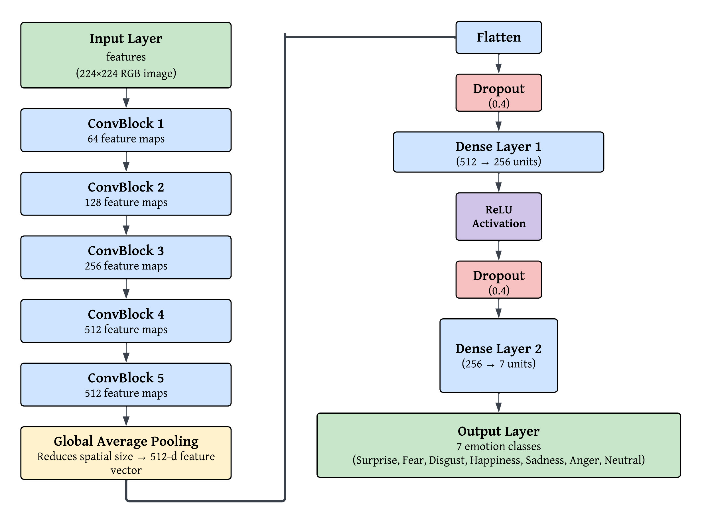
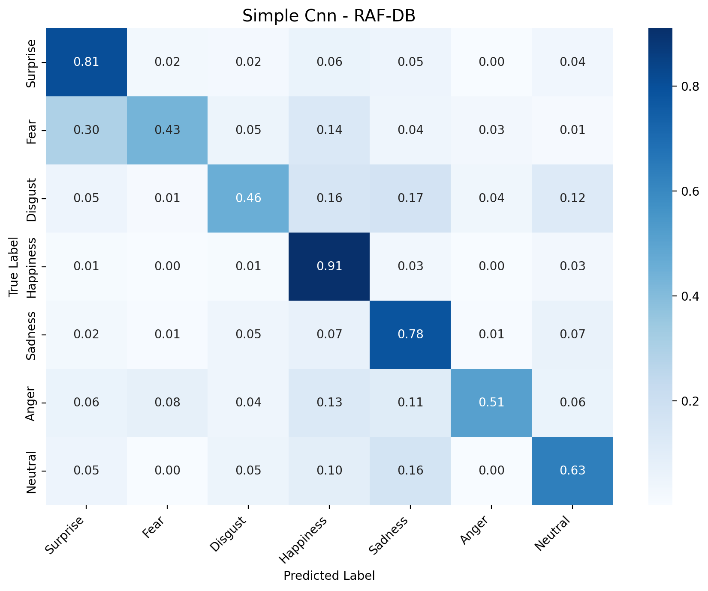
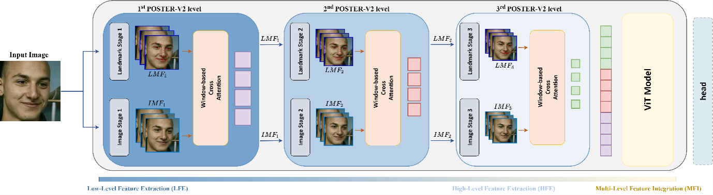
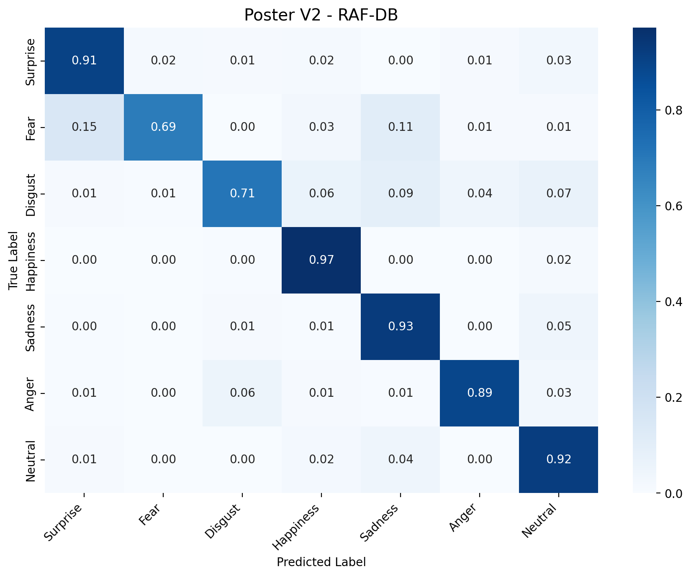
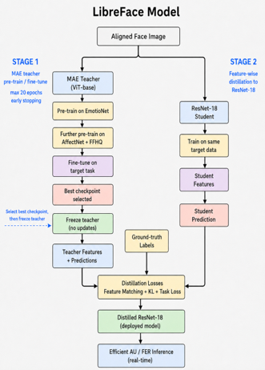
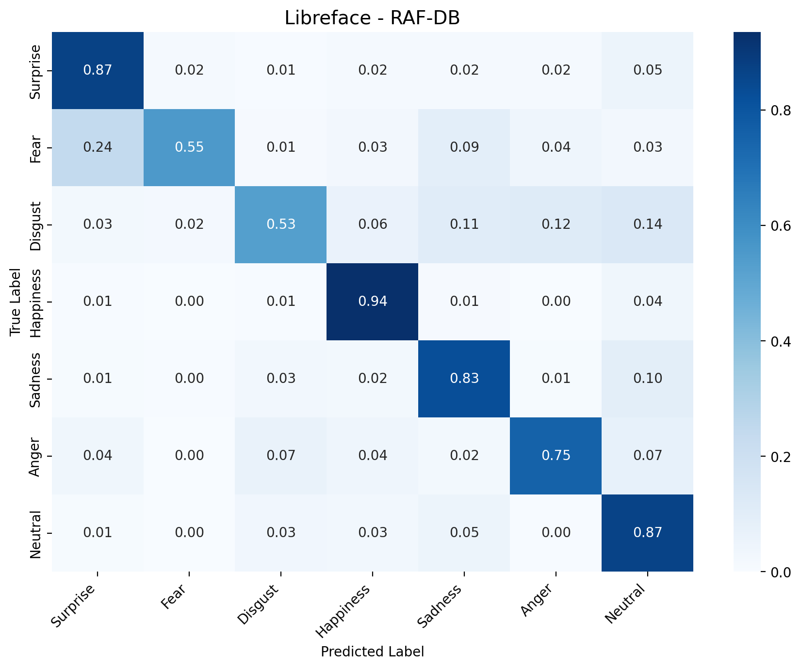

# Comparative Evaluation of Simple CNN, POSTER_V2, and LibreFace for Facial Expression Recognition on RAF-DB

## Overview

This project benchmarks three architectural paradigms for Facial Expression Recognition (FER) on the Real-world Affective Faces Database (RAF-DB) under a unified evaluation framework:

- `Simple CNN`: a lightweight custom Convolutional Neural Network built from scratch, serving as a structural baseline with no pretraining and no attention.
- `POSTER_V2`: a state of the art dual stream pyramid transformer with landmark guided cross attention at three scales.
- `LibreFace`: a modern FER toolkit using an Action Unit based teacher student framework with feature wise knowledge distillation.

All three models share the same CSV prediction schema, train and test split, `224x224` ImageNet normalized preprocessing, and metric computation.


## Dataset

The RAF-DB single label subset contains 15,339 images across 7 classes:

- 12,271 training images
  - split further into 9,816 train and 2,455 validation at a `4:1` ratio
- 3,068 test images
- Original resolution: `100x100`, resized to `224x224` for all models

### Class Distribution

| Class ID | Class Name | Count | Percentage |
|:--------:|:-----------|------:|:----------:|
| 1        | Surprise   | 1,619 | 10.55%     |
| 2        | Fear       | 355   | 2.31%      |
| 3        | Disgust    | 877   | 5.72%      |
| 4        | Happiness  | 5,957 | 38.84%     |
| 5        | Sadness    | 2,460 | 16.04%     |
| 6        | Anger      | 867   | 5.64%      |
| 7        | Neutral    | 3,204 | 20.89%     |

The distribution is heavily imbalanced. Happiness dominates while Fear and Disgust are severely underrepresented. This shape drives most of the per class performance gaps discussed in the Results section.

### Test Set Layout

```
data/raf_db/test/
├── 1/    329  images   (Surprise)
├── 2/    74   images   (Fear)
├── 3/    160  images   (Disgust)
├── 4/    1185 images   (Happiness)
├── 5/    478  images   (Sadness)
├── 6/    162  images   (Anger)
└── 7/    680  images   (Neutral)
```

### Notes

- Advantages: real Internet images with diverse subjects, poses, and lighting. Crowdsourced annotation improves label reliability compared to a single annotator.
- Limitations: resizing removes fine detail, and some emotion pairs share overlapping facial configurations (Fear and Surprise, Disgust and Anger).

## Evaluation Framework

All three models produce predictions in the same CSV schema:

```
image_path, true_label, pred_label, prob_1, prob_2, prob_3, prob_4, prob_5, prob_6, prob_7
```

Rules for prediction CSVs:

- `image_path` must be relative, not absolute.
- `true_label` and `pred_label` are integers `1..7`.
- `prob_1` through `prob_7` must sum to approximately `1.0` per row.
- Class mapping is shared through `data/label_map.json` and `eval/utils.py`.

Since the dataset is class imbalanced, accuracy alone is insufficient. Reported metrics are:

- Overall accuracy
- Weighted F1
- Macro F1
- Per class F1
- Confusion matrix

## Models

Every model exposes the same interface: consume RAF-DB images, produce a `predictions/{model}.csv` file matching the shared schema. Architectures differ, evaluation does not.

### Simple CNN

Custom baseline. No pretraining, no attention. Serves as a floor to measure how much the other two architectures actually buy you.



Architecture:

- Input: RGB `224x224`
- Backbone: 5 conv blocks, each `Conv3x3` -> `BatchNorm` -> `ReLU` -> `MaxPool2x2`
- Channel progression: `3 -> 64 -> 128 -> 256 -> 512 -> 512`
- Spatial progression: `224 -> 112 -> 56 -> 28 -> 14 -> 7`
- Head: `GlobalAvgPool` -> `Dropout` -> `Linear(512, 256)` -> `ReLU` -> `Dropout` -> `Linear(256, 7)`

Training:

| Setting        | Value                                              |
|:---------------|:---------------------------------------------------|
| Optimizer      | `AdamW`                                             |
| Loss           | Cross entropy with label smoothing                 |
| Regularization | Dropout, data augmentation, early stopping         |
| Scheduler      | ReduceLROnPlateau on validation loss               |
| Checkpoint     | `models/simple_cnn/checkpoints/simple_cnn_best.pt` |

Inference emits softmax probabilities, argmax lands in `predictions/simple_cnn.csv`.



### POSTER_V2

State of the art dual stream pyramid transformer. Fuses face recognition features with image appearance features through landmark guided cross attention at three scales. Adapted from the [official repository](https://github.com/Talented-Q/POSTER_V2).



Architecture:

- Appearance stream: `IR-50` on `224x224` input, producing feature maps at `28x28`, `14x14`, `7x7`
- Landmark stream: `MobileFaceNet` on `112x112` input (frozen, `requires_grad=False`), producing face specific queries
- Fusion: `WindowAttentionGlobal` at each pyramid level, with head counts `{28: 2, 14: 4, 7: 8}`
- Aggregation: all outputs projected to 768 dimensions, passed through a lightweight ViT (`depth=2`, `embed_dim=768`)
- Head: 7 class logits

Freezing the MobileFaceNet stream is the design choice that separates POSTER_V2 from a two trainable encoder setup, and is why the reproduction requires three checkpoints rather than one.

Training:

| Setting       | Value                                            |
|:--------------|:-------------------------------------------------|
| Optimizer     | `SAM` (`rho=0.05`) wrapping `Adam`               |
| Learning rate | `3.5e-5`                                          |
| Scheduler     | `ExponentialLR` (`gamma=0.98`)                   |
| Epochs        | 200                                              |
| Batch size    | 144                                              |
| Augmentation  | Random horizontal flip, random erasing (`p=0.5`) |

SAM runs two forward backward passes per step: the first finds the sharpness maximizing weight perturbation, the second updates toward a flatter loss region.

The provided `inference_wrapper.py` remaps 0 indexed class labels to the project's 1 indexed convention so predictions match the shared CSV schema.



### LibreFace

Action Unit based teacher student framework. Adapted from the [official repository](https://github.com/ihp-lab/LibreFace). No official RAF-DB checkpoint exists, so the model was fine tuned locally starting from the AffectNet weights.



Preprocessing pipeline uses `MediaPipe` face mesh and landmark detection to crop the facial region (mouth, eyes, eyebrows, nose) before it reaches the network.

Two stage training:

| Stage | Model                                    | Role                                          |
|:-----:|:-----------------------------------------|:----------------------------------------------|
| 1     | ViT base `MAE` pretrained on `EmotioNet` | Teacher. Up to 20 epochs, early stopping.     |
| 2     | `ResNet-18`                              | Student. Feature wise distillation from frozen teacher, minimized via `KL` divergence. |

Training:

| Setting    | Value                                                       |
|:-----------|:-----------------------------------------------------------|
| Optimizer  | `AdamW`                                                     |
| Losses     | `MSE` for AU intensity, cross entropy for FER, `KL` for distillation |
| Stopping   | Epoch 26 (no further validation improvement)               |
| Checkpoint | `models/libreface/checkpoints_rafdb/libreface_rafdb_best.pt` |

Only the final 7 class logits are consumed for the RAF-DB comparison.



## Results

### Summary Metrics on RAF-DB Test Set (n = 3,068)

| Model      | Accuracy (%) | Weighted F1 (%) | Macro F1 (%) |
|:-----------|:------------:|:---------------:|:------------:|
| Simple CNN | 76.14        | 75.80           | 65.86        |
| POSTER_V2  | 92.18        | 92.09           | 87.34        |
| LibreFace  | 85.72        | 85.62           | 77.58        |

### Per Class F1 (%)

| Model      | Surprise | Fear  | Disgust | Happiness | Sadness | Anger | Neutral |
|:-----------|:--------:|:-----:|:-------:|:---------:|:-------:|:-----:|:-------:|
| Simple CNN | 76.59    | 46.72 | 45.48   | 88.43     | 70.23   | 62.88 | 70.71   |
| POSTER_V2  | 90.85    | 76.12 | 75.75   | 97.05     | 90.70   | 89.72 | 91.19   |
| LibreFace  | 86.97    | 64.06 | 55.74   | 94.30     | 82.93   | 75.54 | 83.53   |

### Observations

- Fear and Disgust are the hardest classes across every model. Simple CNN scores closely on both (`46.72%` and `45.48%`). POSTER_V2 shows a gap of `29.4` and `30.3` points respectively between its best and worst classes. LibreFace closes much of the gap but still trails POSTER_V2 by `12.1` points on Fear and `20.0` points on Disgust.
- Cross model misclassification is concentrated on Fear vs Surprise and Disgust vs Anger, where facial configurations overlap.
- Deployment tradeoffs:
  - Simple CNN suits real time CPU inference where accuracy is a secondary concern.
  - POSTER_V2 delivers the highest accuracy but requires 3 pretrained weight files and a GPU.
  - LibreFace offers a middle ground with a single `ResNet-18` forward pass and one checkpoint.

## Setup and How to Run

All three models were tested on Windows with an NVIDIA GeForce RTX 5070 Laptop GPU. The Blackwell architecture (`sm_120`) requires `CUDA 12.8`. Verify with an actual tensor computation, not just `torch.cuda.is_available()`:

```bat
python -c "import torch; t = torch.tensor([2.0]).cuda(); print(t * t); print(torch.cuda.get_device_capability())"
```

Expected: `tensor([4.], device='cuda:0')` and `(12, 0)`.

### Simple CNN

```bat
cd models\simple_cnn
pip uninstall torch torchvision -y
pip install --pre torch torchvision --index-url https://download.pytorch.org/whl/nightly/cu128 --no-cache-dir

python train.py --no-class-weights --lr 3e-4 --epochs 60
python inference.py --split test

cd ..\..\scripts
python consolidate.py
python generate_results.py
```

Best checkpoint saves to `models/simple_cnn/checkpoints/simple_cnn_best.pt`. Predictions go to `predictions/simple_cnn.csv`. Use `--no-cache-dir` to prevent pip reusing an incompatible cached build.

Tips:

- Plain cross entropy usually beats class weighted CE on headline accuracy. Class weights help minority F1 but hurt overall accuracy.
- Do not over augment. RAF-DB faces are aligned.
- Start with `batch 64`. The model is roughly 4M parameters.

### POSTER_V2

Expected result: approximately 92% accuracy on the test set.

```bat
conda create -n poster_v2 python=3.10 -y
conda activate poster_v2
cd models\poster_v2
pip install torch torchvision --index-url https://download.pytorch.org/whl/cu128
pip install -r requirements.txt
echo. > models\__init__.py
echo. > data_preprocessing\__init__.py
python download_weights.py
python inference_wrapper.py --config config.yaml
```

`download_weights.py` fetches three files (roughly 356 MB total) from the official Google Drive links and skips any that already exist:

| File                                        | Size   | Description                     |
|:--------------------------------------------|:------:|:--------------------------------|
| `checkpoint/rafdb_best.pth`                 | 241 MB | POSTER_V2 trained on RAF-DB     |
| `pretrain/ir50.pth`                         | 122 MB | IR-50 face recognition backbone |
| `pretrain/mobilefacenet_model_best.pth.tar` | 12 MB  | MobileFaceNet landmark detector |

The `echo.` lines recreate empty `__init__.py` files that Windows sometimes drops during extraction.

Troubleshooting:

| Error                                                    | Fix                                                     |
|:---------------------------------------------------------|:--------------------------------------------------------|
| `No module named 'models'`                               | Re-run the `echo.` commands                             |
| `No checkpoint found`                                    | Re-run `python download_weights.py`                     |
| `CUDA: False` or `no kernel image is available`          | Reinstall PyTorch with the `cu128` index (needs `>=2.6.0`) |
| `cannot import name 'trunc_normal_' from 'timm.models.layers'` | `pip install --upgrade "timm>=1.0.0"`             |
| Google Drive quota                                       | Download manually from the links in `download_weights.py` |

### LibreFace

Two workflows exist. Only workflow 2 produces the reported result:

- `inference.py`: pretrained AffectNet baseline, no fine tuning.
- `train.py` + `inference_finetuned.py`: RAF-DB fine tuned. Starts from `checkpoints_fm_resnet/AffectNet/resnet.pt`, replaces the 8 class classifier with a 7 class one, saves to `checkpoints_rafdb/libreface_rafdb_best.pt`.

Setup:

```bash
conda activate libreface_test
pip uninstall torch torchvision torchaudio -y
pip cache purge
pip install --pre torch torchvision torchaudio --index-url https://download.pytorch.org/whl/nightly/cu128 --no-cache-dir
pip install pandas numpy pillow tqdm matplotlib seaborn scikit-learn
```

Train and infer:

```bash
cd models\libreface
python train.py --device cuda --batch-size 64 --epochs 100 --lr 1e-4 --freeze-encoder-epochs 3
python inference_finetuned.py --split test --device cuda --batch-size 64

cd ..\..
python scripts\generate_results.py
```

Schedule: epochs 1 to 3 train only the new classifier, epoch 4 onward unfreezes the encoder. Drop `--batch-size` to `32` if CUDA runs out of memory. Labels are handled as `0..6` internally (PyTorch `CrossEntropyLoss` requirement) and converted back to `1..7` on output.

## Conclusion

POSTER_V2 delivers the highest performance on RAF-DB, followed by LibreFace and the Simple CNN baseline. The comparison highlights the importance of pretrained encoders and structured attention over raw convolutional stacks. Fear and Disgust remain the most difficult classes across all three architectures, reflecting both dataset imbalance and the visual similarity of these expressions to Surprise and Anger respectively.

Future work includes real time deployment on webcam input to evaluate robustness under blur, lighting changes, pose variation, and occlusion.